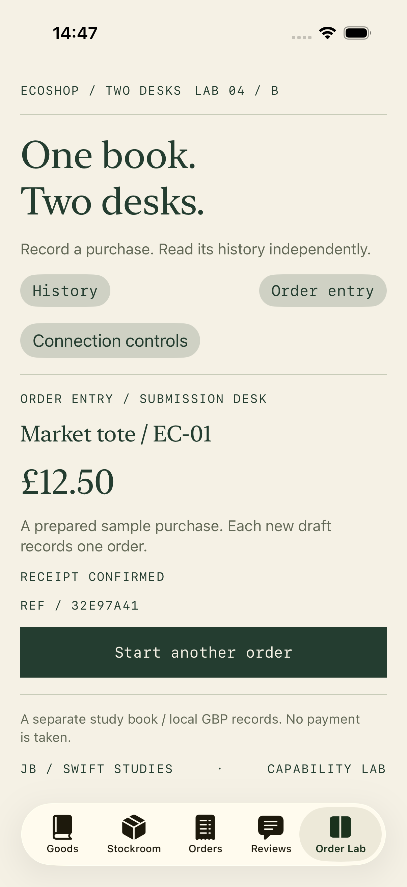
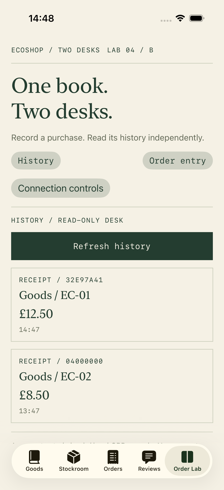
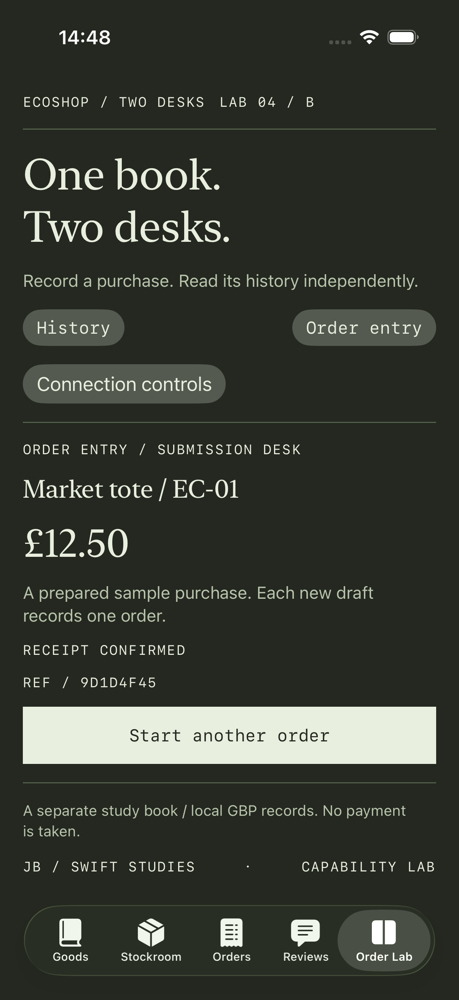
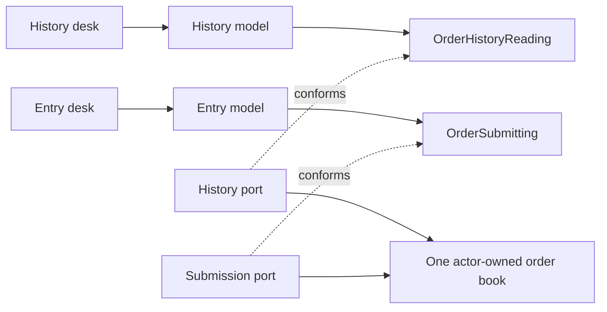

# 04 / B · One book, two desks

[Foundation lesson](../README.md) · [Learning progression](../../docs/LEARNING_PATH.md) · [Setup](../../docs/SETUP.md)

The Goods/Stockroom lesson separates catalog reads from mutations. This lab introduces independent consumers of a complete order workflow: **entry confirms a purchase through submission alone; history reads records without acquiring write operations**.

## Scenario and scope

A clerk records a prepared purchase and receives an acknowledgement. Another desk reads the shared book. History can be unavailable while entry still works, and vice versa. A successful write must not be presented as a failure merely because history cannot refresh.

Select **Order Lab** in the [same app project](../EcoShop%20Backend%20ISP.xcodeproj). It uses a separate study book from the original Orders tab. Within the lab both desks share one store. Records last for the retained lab session, not across process termination. The original four tabs and their fixtures remain the foundation example.

This is a local manual ledger: no payment, catalog lookup, persistence, authentication, authorization, network service or real checkout. The prepared order records EC-01 at £12.50; it does not derive a price from Goods. Amounts use integer GBP pence and Decimal display in this track; the original models still use Double.

## Compare the scope of thinking

| Scope | Question | Evidence |
| --- | --- | --- |
| Foundation | Can a catalog reader avoid implementing writes? | Read-only fixtures and a writer-only editor |
| Feature ownership | Can entry confirm, fail and retry without querying history? | Narrow models, receipt validation, separate failure messages |
| System ownership | How do consumers evolve independently while sharing state? | Capability contracts, retained composition, explicit refresh policy and receipt/retry semantics |

ISP does not require one protocol per method or a separate database per interface. These two workflows currently need one operation each. Add cohesive operations when a consumer has a concrete need; do not split merely to increase the protocol count.

## Try the running lab

1. Open **Order Lab**: history shows a seeded EC-02 receipt.
2. Open **Connection controls**, choose **Take history offline**, close the controls, then **Order entry** and **Record this order**. Entry confirms its receipt without consulting history.
3. Return to **History**: a warning distinguishes retained, previously loaded records from a successful refresh. The new EC-01 record is not visible yet.
4. Open the controls and choose **Restore history**, then close them: a new snapshot includes the acknowledged order. Read state changes without altering the confirmed write outcome.
5. Use the connection controls to take entry offline and attempt another prepared order. Restore it and retry: the same draft identity and payload are reused.
6. **Start another order** creates a new identity only after acknowledgement. Repeated taps cannot silently create a second order.

Changing desks does not cancel a submission; the retained entry model owns it. Leaving the lab tab cancels outstanding consumer tasks. If a write committed before cancellation or its acknowledgement was lost, cancellation cannot undo that commit. A retry must reuse the same immutable draft.

Actual simulator screenshots from passing UI tests. The matching receipt reference connects the two desks.

Dark appearance

## Contracts and consumers

| Consumer | Interface | Needs | Does not need |
| --- | --- | --- | --- |
| History model/desk | `OrderHistoryReading` | Snapshot of recorded orders | Submission, editing, cancellation, catalog lookup |
| Entry model/desk | `OrderSubmitting` | Submit a draft and receive its acknowledgement | History lookup or reload, product/review services |
| Composition session | Concrete shared store and demo ports | Assemble and retain both consumers | Pretend the consumer interfaces are security permissions |

The store validates nonblank references and nonnegative totals. The same draft ID and payload return the original receipt; reusing an ID with a different payload fails. Commit and identity checks contain no suspension. History returns a snapshot in newest-commit-first order. It updates on entering the history desk or explicit refresh; it is not a live subscription.

History loading preserves its last successful snapshot on failure and rejects obsolete results. Entry validates that an acknowledgement matches the submitted draft. Confirmation and history freshness are separate states. A permanent identity conflict is not classified as an outage to retry.

## Read the source

1. [OrderCapabilities.swift](../EcoShop%20Backend%20ISP/Advanced/OrderCapabilities.swift): immutable values and the two consumer-facing contracts.
2. [OrderHistoryModel.swift](../EcoShop%20Backend%20ISP/Advanced/OrderHistoryModel.swift): one reader dependency, retained snapshots and loading ownership.
3. [OrderEntryModel.swift](../EcoShop%20Backend%20ISP/Advanced/OrderEntryModel.swift): one submitter dependency, stable draft identity, acknowledgement and failure handling.
4. [OrderBookStore.swift](../EcoShop%20Backend%20ISP/Advanced/OrderBookStore.swift): one actor implementing both capabilities, plus independently controlled local ports.
5. [OrderLabSession.swift](../EcoShop%20Backend%20ISP/Advanced/OrderLabSession.swift): retain the whole graph for both desks.
6. [OrderWorkflowLab.swift](../EcoShop%20Backend%20ISP/Advanced/OrderWorkflowLab.swift): composition selects the desk and demo faults; the child desks observe narrow models.

## Evidence and limits

[OrderCapabilityTests.swift](../EcoShop%20Backend%20ISPTests/OrderCapabilityTests.swift) constructs real consumers with fixtures that lack the other capability. It checks independent write success during a history outage, concurrent duplicate submissions, receipt mismatch, permanent ID conflict, cancelled acknowledgements, and older history completions. Controlled continuations establish completion order rather than short sleeps.

[UI tests](../EcoShop%20Backend%20ISPUITests/EcoShop_Backend_ISPUITests.swift) cover offline history with successful entry, entry retry without duplicate records, and the largest accessibility text size. Use the [common test runner](../../docs/SETUP.md#execute-tests-from-terminal).

Interface segregation limits the dependency a client receives. It is not authorization, a guarantee of independent infrastructure availability, or automatic state synchronization. The lab injects port failures while the shared store stays healthy. Read [the decision record](DECISION.md) before generalising these choices to an external service.

Continue with the [cancellation-desk exercise](EXERCISE.md), its separate solution, and the [interview prompts](INTERVIEW.md).
