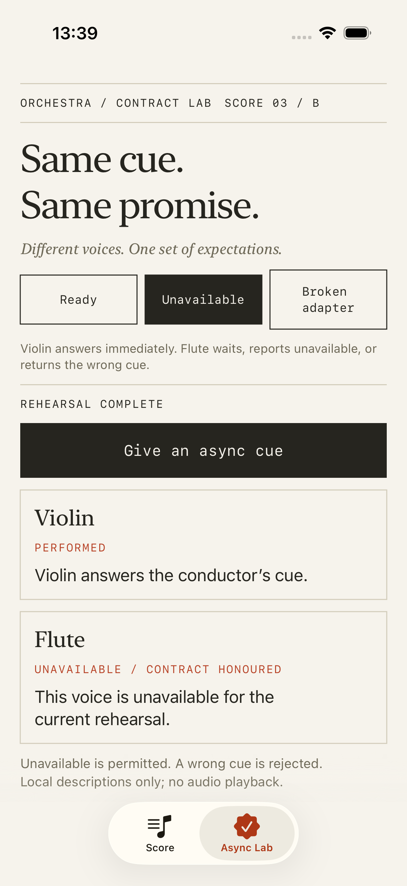
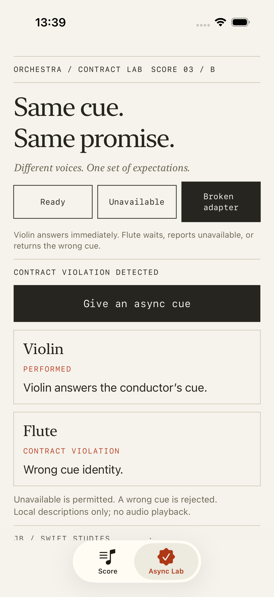
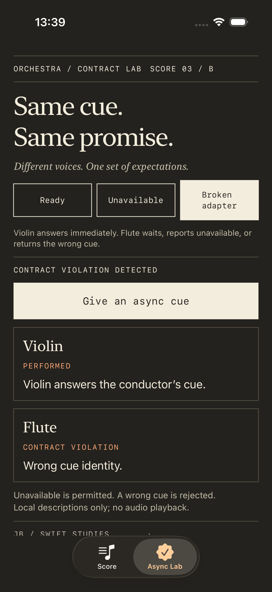
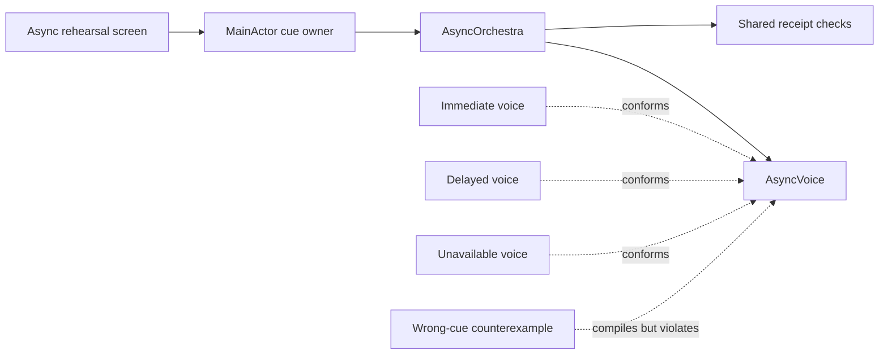

# 03 / B · Same cue, same promise

[Foundation lesson](../README.md) · [Learning progression](../../docs/LEARNING_PATH.md) · [Setup](../../docs/SETUP.md)

Dependency Inversion asks which dependency the consumer receives. Liskov Substitution asks what that consumer can rely on. This lab makes the second question concrete when implementations become asynchronous.

## Scenario

A conductor sends the same cue to a collection of voices. Voices may answer immediately, take a rest, or be unavailable. The conductor needs one usable report per voice, in ensemble order. The user can cancel or replace a cue, or change the ensemble before old work finishes.

These are local descriptive performances, not audio playback, network requests, or a real-time musical clock. A delayed result is permitted. An unavailable result is permitted. A receipt for the wrong cue violates the contract even though the conformer compiles.

## Compare the scope of thinking

| Scope | Main question | Evidence |
| --- | --- | --- |
| Foundation | Can every `Playable` work without concrete preparation? | Repeated synchronous calls and identity checks |
| Feature ownership | Can the UI cancel, retry and avoid stale reports? | Screen-owned tasks, cue identity, accessible interactions |
| System ownership | What can every async implementation promise, and what can the caller contain? | Explicit outcome/cancellation contract, shared checks, deterministic completion order, resource-lifetime discussion |

More protocols would not solve an incorrect receipt. A slower implementation is not automatically an LSP violation. A recoverable failure is not automatically an LSP violation either: judge both against the abstraction's declared expectations.

## Run and compare

Open [LSPExample.xcodeproj](../LSPExample.xcodeproj), run its scheme, and select **Async Lab**. The original **Score** tab remains the synchronous foundation.

| Source | Violin | Flute | Expected interpretation |
| --- | --- | --- | --- |
| Ready | Immediate receipt | Receipt after three seconds | Both honour the same contract |
| Unavailable | Valid receipt | Declared unavailable outcome | A permitted failure; the valid voice still appears |
| Broken adapter | Valid receipt | Receipt for a different cue | A weakened postcondition; its receipt is rejected |

Press **Give an async cue**. During a delayed cue, use **Cancel cue** or **Replace the cue**. Changing sources resets the current cue. Leaving the tab cancels its screen-owned task. The caller does not cast a voice or require tuning, audio files, or preparation.

Actual iPhone simulator screenshots exported from passing UI tests.

Dark appearance

## State the contract first

[AsyncVoice.swift](../LSPExample/Advanced/AsyncVoice.swift) defines the expectations for this exercise:

| Requirement | Every conformer must honour |
| --- | --- |
| Identity | Keep the same nonblank name and voice ID during and between performances |
| Successful result | Return the requested cue ID and its own voice ID, with nonblank text containing its name |
| Expected failure | Return `.unavailable` with a nonblank reason |
| Thrown error | Only `CancellationError`; other errors must be mapped to a declared outcome |
| Cancellation | Check cancellation at entry and after its own suspension; do not turn cancellation into normal success |
| Repeatability | Subsequent cues work without extra preparation, including after cancellation |
| Completion | Each finite invocation supplies one terminal response; no wall-clock deadline is promised |

The conductor separately requires unique voice IDs within an ensemble. That is a collection precondition, not an extra preparation requirement imposed by a particular conformer. An empty ensemble produces an empty report; the lab's composition supplies two voices.

The synchronous and asynchronous protocols are separate abstractions. Changing the original `Playable.play()` to throw new errors would change what its existing callers can assume. In this exercise an unavailable response is explicitly part of the new async contract.

## Read the implementation

1. [AsyncVoice.swift](../LSPExample/Advanced/AsyncVoice.swift): compare Swift signatures with the documented semantics and shared value checks.
2. [AsyncVoices.swift](../LSPExample/Advanced/AsyncVoices.swift): immediate, delayed and unavailable implementations; the clearly marked wrong-cue counterexample.
3. [AsyncOrchestra.swift](../LSPExample/Advanced/AsyncOrchestra.swift): one operation for every voice, concurrent children, stable ensemble ordering and per-voice violation reports.
4. [AsyncRehearsalModel.swift](../LSPExample/Advanced/AsyncRehearsalModel.swift): establish cue identity before starting work, cancel immediately, and reject old publication.
5. [AsyncRehearsalComposition.swift](../LSPExample/Advanced/AsyncRehearsalComposition.swift): the only concrete scenario switch.
6. [AsyncRehearsalView.swift](../LSPExample/Advanced/AsyncRehearsalView.swift): compare an allowed unavailable response with a rejected receipt in the score's visual language.

## What the tests establish

[AsyncVoiceTests.swift](../LSPExampleTests/AsyncVoiceTests.swift) checks the same repeated outcome and cancelled-entry expectations across supported voices. A controlled pause tests cancellation after suspension and reuse afterwards. Negative fixtures expose wrong cue/voice identity, blank results, undeclared preparation errors and ignored cancellation.

The conductor tests release the second voice before the first and verify ensemble order. Separate lifecycle tests use a noncooperative fixture to establish that UI cancellation is immediate and an obsolete cue cannot overwrite a new report. Continuations establish arrival and completion order; correctness does not depend on short sleeps.

[UI tests](../LSPExampleUITests/LSPExampleUITests.swift) compare unavailable and broken responses, cancel and repeat a delayed cue, and navigate the report at the largest accessibility text size. Their slow cancellation fixture uses eight seconds; the normal lab uses three.

These checks provide evidence, not a proof of every future conformer. Runtime value checks contain malformed results and undeclared errors. They cannot make a conformer that ignores cancellation cooperative, stop arbitrary side effects, or force one that never returns to finish. Swift's [structured concurrency proposal](https://github.com/swiftlang/swift-evolution/blob/main/proposals/0304-structured-concurrency.md) describes task-group scope and cooperative cancellation; the lab's UI publication guard does not change those lifetimes.

Read the [decision record](DECISION.md), attempt the [contract-evolution exercise](EXERCISE.md), and practise the [interview prompts](INTERVIEW.md) before opening their answer notes.
