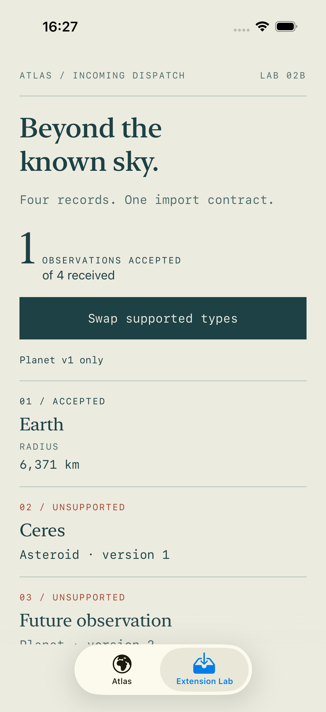
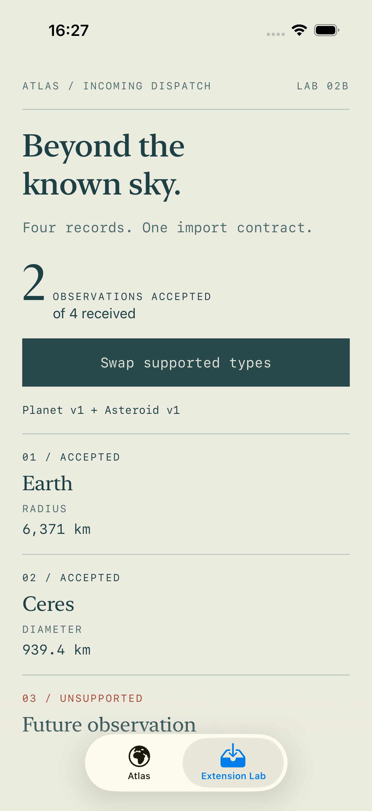
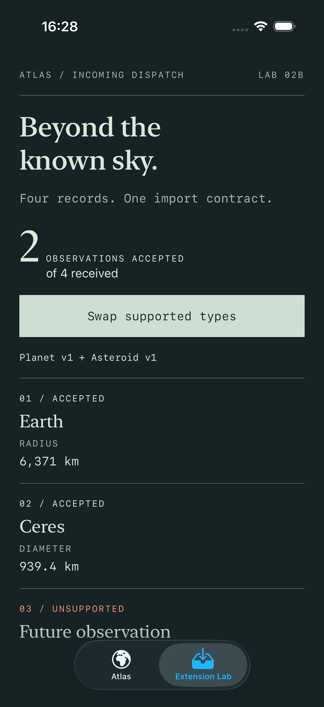
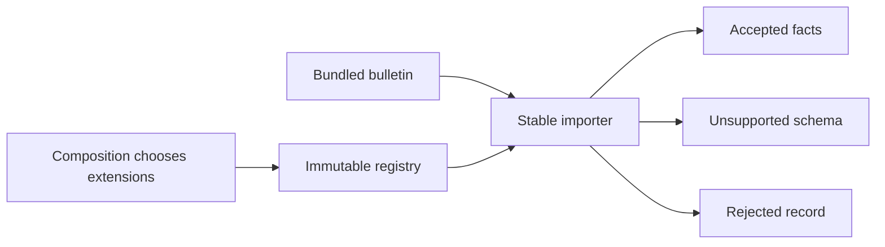

# Beyond the known sky · extension contracts

[Foundation atlas](../README.md) · [Learning progression](../../docs/LEARNING_PATH.md) · [Setup](../../docs/SETUP.md)

A bulletin contains valid observations, a type this release does not support, a future payload version, and a damaged record. How should an older app keep useful information readable without guessing what unfamiliar data means?

Run the OCP app and choose **Extension Lab**. The base registry accepts Earth. **Swap supported types** composes a new immutable registry; Ceres becomes readable through the same importer. The future version remains unsupported and the negative radius remains rejected. The original Atlas tab still uses its foundation registry and dataset.

## What changes in the thinking?

| Scope | Question | Evidence |
| --- | --- | --- |
| Foundation | Can another conformer decode without editing lookup? | Test-only asteroid in the original registry |
| Feature ownership | What can users still read when one record fails? | Ordered report with accepted, unsupported and rejected rows |
| System ownership | How do releases agree on extension keys and payload meaning? | Exact type/version dispatch, duplicate-registration errors, immutable composition and compatibility tests |

These are scopes of reasoning, not job titles. A closed enum can be the stronger choice when the supported set is deliberately fixed.

## Contract

- The document must be valid JSON with an array at its root. Invalid documents throw; an empty array succeeds with no rows.
- Each envelope has a UUID, nonblank `type` and `name`, and a positive integer `version`. Names are display data; IDs identify domain records. Type keys are case-sensitive and are not trimmed or aliased for lookup.
- The first valid envelope claims its UUID, even if its payload is unsupported or invalid. Later duplicates are rejected. This is a study policy, not a universal merge rule.
- An exact `(type, version)` registration is required. Unknown types and versions are **unsupported**. Their payloads are not decoded, and version 2 never silently falls back to version 1.
- Registered decoders own payload validation. Bad payloads are **rejected** without losing other rows. A decoder must return at least one fact with nonblank labels and values; invalid output is contained.
- The importer preserves input order and supplies presentation identity by row index. That index is not a persistent entity ID.
- Registry construction rejects invalid or duplicate keys. The resulting value has no mutation API. Closures are `@Sendable`, outputs are Sendable values, and each call creates its own JSON decoder.

Changing composition is expected. Adding a new extension does not edit the import loop or report view. Changing document-level policies, such as duplicate handling, **does** require changing that boundary: OCP is selective, not a promise that algorithms never evolve.

## Read the source

1. [AtlasExtensionRegistry.swift](../Closed-Principle-%28OCP%29-Galactic-Explorer/Advanced/AtlasExtensionRegistry.swift): schema keys, registration validation and immutable lookup.
2. [AtlasImport.swift](../Closed-Principle-%28OCP%29-Galactic-Explorer/Advanced/AtlasImport.swift): envelope validation, duplicate policy and per-record recovery.
3. [AtlasLabComposition.swift](../Closed-Principle-%28OCP%29-Galactic-Explorer/Advanced/AtlasLabComposition.swift): Planet v1 and Asteroid v1 payloads, positive measurements and the offline bulletin.
4. [AtlasExtensionLab.swift](../Closed-Principle-%28OCP%29-Galactic-Explorer/Advanced/AtlasExtensionLab.swift): uniform reporting, accessible labels and registry recomposition.
5. [AtlasExtensionTests.swift](../Closed-Principle-%28OCP%29-Galactic-ExplorerTests/AtlasExtensionTests.swift): a test-only comet extends the importer; adding Ceres leaves all other outcomes unchanged.

## Evidence and limits

Tests cover unknown versions, bad envelopes and payloads, duplicate keys and IDs, additive fields, invalid extension output, empty documents, and concurrent imports through one immutable registry. UI tests compare base/extended results and exercise accessibility text; foundation selection tests remain in place.

The foundation's mutable `@unchecked Sendable` registry is retained as a documented teaching limitation. The advanced registry avoids that declaration. Swift's [Sendable contract](https://docs.swift.org/latest/documentation/swift/sendable/) covers transfer safety; it does not prove a plugin returns truthful measurements or terminates. A concurrency test supplements the value/closure design; it is not a general race detector. The project still uses Swift 5 language mode.

This is a small synchronous, in-memory import. It reads and reserializes each JSON record, has no streaming or size limits, and does not retain unsupported payloads for later replay. Switching the demo registry reimports the same bundled bytes. There are no downloaded executable plugins, database migrations, network requests, scientific coordinate calculations, or release negotiation. A production importer needs bounded input, diagnostics, schema documentation and a measured rollout.

[Decision and alternatives](DECISION.md) · [Try the version-evolution exercise](EXERCISE.md) · [Interview prompts](INTERVIEW.md)
