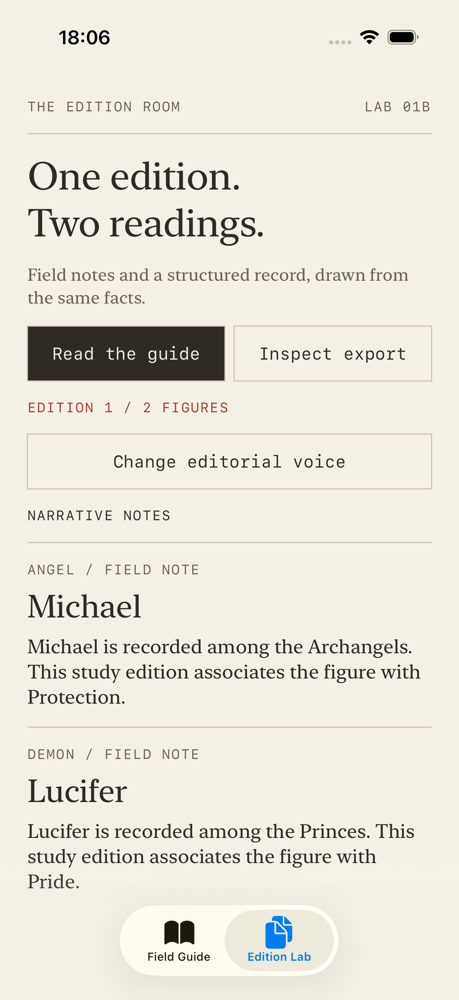
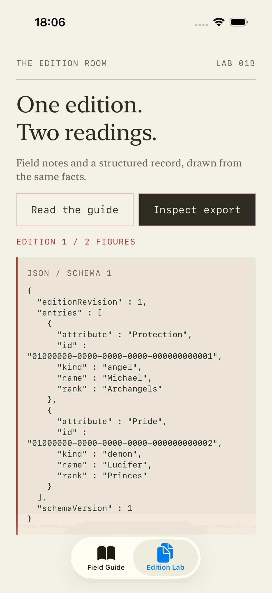
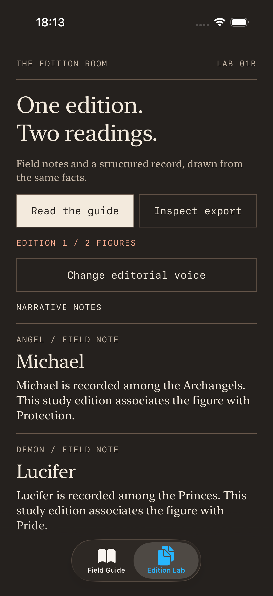
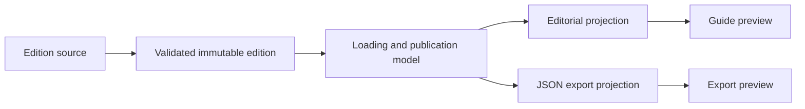

# The edition room · ownership of change

[Foundation field guide](../README.md) · [Learning progression](../../docs/LEARNING_PATH.md) · [Setup](../../docs/SETUP.md)

An editor wants shorter field notes. An export consumer needs stable JSON fields. A data supplier corrects an attribute. These requests concern the same figures, but they should not all change the same type.

Run the SRP app and select **Edition Lab**. **Read the guide** shows editorial prose. **Inspect export** shows JSON from the same edition. Change the editorial voice, then inspect the export again: the structured record stays identical. **Switch sample edition** changes Michael's source attribute from Protection to Guardianship; both consumers then show the new facts. **Toggle source connection** demonstrates a failed refresh while retaining the previous edition.

## What changes in the thinking?

| Scope | Question | Evidence |
| --- | --- | --- |
| Foundation | Can descriptions change independently of loading and layout? | Model/hierarchy description tests |
| Feature ownership | Can a failed refresh leave useful content readable? | Retained edition, explicit warnings, cancellation and accessibility |
| System ownership | Which consumer owns wording, schema and data invariants? | Separate projections, shared validation, consistent snapshot publication and a migration decision |

These describe exercise scope, not a hiring rubric. The useful question is who requests the change and what must remain stable. Robert Martin's [SRP explanation](https://blog.cleancoder.com/uncle-bob/2014/05/08/SingleReponsibilityPrinciple.html) ties responsibility to sources of change. Here an editor or integration consumer is a stakeholder role; that meaning of “actor” differs from Swift's concurrency `actor`.

## Give each decision a home

| Change request | Owner | Unrelated behaviour to protect |
| --- | --- | --- |
| Correct a figure or supply another edition | `GuideEditionSource` / sample supplier | Editorial policy and JSON schema |
| Reject duplicate identity or incomplete facts | `GuideEdition` | Both consumers must receive valid data |
| Rewrite sentences or annotations | `GuideEditorial` | Source facts and export fields |
| Rename a machine field or version the export | `GuideExportDocument` / `GuideExport` | Guide prose and loading |
| Change refresh, retention or publication policy | `GuideEditionModel` | Wording and encoding |
| Change paper, typography or controls | SwiftUI previews and `GuideStyle` | Source access and export bytes |

The model has several operations because loading, failure and cancellation are parts of one publication policy. The lesson does not create a protocol for every formatter: concrete value types already let those policies change independently.

## Contract

An edition has a positive revision, unique UUIDs and nonblank names, attributes and ranks. An empty edition is valid. Shared invariants are checked at construction, before either consumer reads the value. Names need not be unique; identity is separate.

The model publishes a complete immutable edition in one assignment. Both projections use that retained value. Switching consumers or editorial voice does not fetch data. A refresh keeps the previous edition visible while loading; failure retains it for both readers. Initial failure remains distinct from a successful empty edition. Cancellation and superseded requests cannot publish late content or warnings.

The guide preserves source order and projects English narrative or index notes. Export schema 1 contains `schemaVersion`, `editionRevision`, and `entries`; each entry has `id`, `kind`, `name`, `attribute`, and `rank`. It excludes display prose. Entries are sorted by UUID and keys are sorted for repeatable local previews. This is not a canonical JSON signing format or a guarantee of identical encoding across OS versions.

Requested sample revision and loaded revision are separate. A failed attempt never relabels the previous edition. Request ordering wins at publication; the model does not promise monotonically increasing server revisions. The sample switch deliberately alternates revisions 1 and 2.

## Read the source

1. [GuideEdition.swift](../SRP-Example-Angels-and-Demons/SRP-Example-Angels-and-Demons/Advanced/GuideEdition.swift): immutable data, shared invariants and the source contract.
2. [GuideEditorial.swift](../SRP-Example-Angels-and-Demons/SRP-Example-Angels-and-Demons/Advanced/GuideEditorial.swift): two prose policies without source or encoder access.
3. [GuideExport.swift](../SRP-Example-Angels-and-Demons/SRP-Example-Angels-and-Demons/Advanced/GuideExport.swift): consumer-owned DTO fields and schema version.
4. [GuideEditionModel.swift](../SRP-Example-Angels-and-Demons/SRP-Example-Angels-and-Demons/Advanced/GuideEditionModel.swift): loading, retained data and request identity.
5. [GuideLabComposition.swift](../SRP-Example-Angels-and-Demons/SRP-Example-Angels-and-Demons/Advanced/GuideLabComposition.swift): the sample source and retained session.
6. [GuideOwnershipLab.swift](../SRP-Example-Angels-and-Demons/SRP-Example-Angels-and-Demons/Advanced/GuideOwnershipLab.swift): separate guide/export consumers and demo controls.
7. [GuideOwnershipTests.swift](../SRP-Example-Angels-and-Demons/SRP-Example-Angels-and-DemonsTests/GuideOwnershipTests.swift): wording isolation, export contracts, retained data and controlled completion order.

## Evidence and limits

Tests compare export bytes before and after editorial changes, verify the exact JSON field set, preserve identities, handle escaped strings, and show that repeated projections need only one source read. Controlled continuations exercise late success, late failure and cancellation without sleeps. UI tests check both consumers, corrected facts, offline retention and accessibility text. Foundation tests remain in place.

The lab has its own sample edition, separate from the original Angels/Demons supplier. Facts and ranks are fictional study fixtures. There is no file saving, network service, persistence, complete localisation, server revision conflict handling or export migration framework. The JSON preview demonstrates serialization, not a finished sharing workflow. Formatting occurs synchronously for two figures; a large catalog would require measured performance and work placement. The retained session lives within this tab/window, and the project remains in Swift 5 language mode.

[Decision and alternatives](DECISION.md) · [Try the localisation exercise](EXERCISE.md) · [Interview prompts](INTERVIEW.md)
